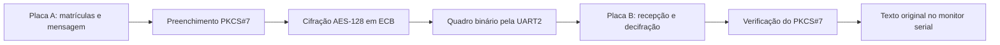

# AES-128 em dois ESP32 via UART

**Implementação didática de criptografia simétrica, com cifração na placa A e recuperação da mensagem na placa B.**

Projeto desenvolvido para a disciplina de **Segurança de Sistemas de Computação**, do IFMT. O algoritmo AES-128 foi implementado em C++ com operações sobre bytes, sem utilizar bibliotecas criptográficas. A comunicação entre as placas utiliza a UART2; o monitor serial do computador apresenta as etapas do processamento.

| Plataforma | Desenvolvimento | Cifra | Comunicação |
| --- | --- | --- | --- |
| ESP32 Dev Module | Arduino e PlatformIO | AES-128 em modo ECB | UART2, 115200 bit/s, 8N1 |

> **Estado do projeto:** o núcleo AES e o protocolo foram conferidos no computador. A transmissão entre duas placas ESP32 físicas e a demonstração em bancada **ainda estão pendentes**.

## Navegação

- [Funcionamento](#funcionamento)
- [Organização do repositório](#organização-do-repositório)
- [Materiais e ferramentas](#materiais-e-ferramentas)
- [Ligação entre as placas](#ligação-entre-as-placas)
- [Compilação e gravação](#compilação-e-gravação)
- [O que aparece no monitor serial](#o-que-aparece-no-monitor-serial)
- [Protocolo de comunicação](#protocolo-de-comunicação)
- [Dados e resultados da dupla](#dados-e-resultados-da-dupla)
- [Validação e limitações](#validação-e-limitações)
- [Solução de problemas](#solução-de-problemas)
- [Autores e documentos](#autores-e-documentos)

## Funcionamento

As placas usam a mesma chave de 16 bytes. A placa A prepara e cifra a mensagem; a placa B recebe os bytes criptografados e usa essa chave para recuperar o texto original.



O processamento segue estas etapas:

1. **Validar o AES:** ao iniciar, cada placa confere a cifração e a decifração com dois vetores oficiais do FIPS-197.
2. **Formar a chave:** concatenar os oito últimos dígitos da matrícula A com os oito últimos da matrícula B, usando os códigos ASCII dos caracteres.
3. **Preparar a mensagem:** montar `A:<matrícula A>;B:<matrícula B>` e acrescentar o preenchimento PKCS#7 para completar blocos de 16 bytes.
4. **Cifrar e enviar:** a placa A cifra cada bloco separadamente e envia um quadro binário. O primeiro envio ocorre na inicialização; os seguintes ocorrem a cada cinco segundos.
5. **Receber e descriptografar:** a placa B aguarda o quadro completo, decifra os blocos, verifica o preenchimento e exibe a mensagem recuperada.

O transmissor também mostra as chaves das rodadas 0 e 1, cinco estados da primeira rodada, o efeito de alterar um bit da chave e um exemplo de repetição de blocos em ECB.

### O que foi implementado no AES

O AES-128 processa blocos de **16 bytes** e usa uma chave de **16 bytes**, equivalentes a 128 bits. A expansão gera 176 bytes: a chave inicial e as dez chaves das rodadas seguintes.

| Operação | Função no algoritmo |
| --- | --- |
| `SubBytes` | Substitui cada byte por um valor da tabela S-box. |
| `ShiftRows` | Desloca os bytes de cada linha do estado. |
| `MixColumns` | Combina os bytes de cada coluna usando a aritmética do AES. |
| `AddRoundKey` | Combina o estado com a chave da rodada por meio de XOR. |
| Expansão da chave | Produz as chaves utilizadas nas rodadas. |
| Operações inversas | Desfazem as transformações durante a decifração. |

O estado é uma matriz de quatro linhas e quatro colunas, armazenada em um vetor de 16 bytes por colunas. A cifração começa com `AddRoundKey`; depois executa dez rodadas. A décima rodada não utiliza `MixColumns`.

As tabelas S-box e S-box inversa estão no código. A S-box do AES resulta do inverso multiplicativo em GF(2⁸), seguido de uma transformação afim. GF(2⁸) é a aritmética de 256 elementos usada pelo algoritmo; as multiplicações foram implementadas com deslocamentos e XOR, incluindo a operação `xtime`.

## Organização do repositório

O projeto PlatformIO fica dentro da pasta **`aes128-esp32-uart/`**. Os comandos de compilação e gravação devem ser executados nessa pasta.

```text
AES-128/
├── README.md
├── Trabalho_AES-128_ESP32-52f81aa25331404097dcc1c128bb9b56.pdf
└── aes128-esp32-uart/
    ├── platformio.ini       # Ambiente de compilação para ESP32 e Arduino.
    ├── include/
    │   ├── aes128.h         # Declarações das operações do AES.
    │   └── protocol.h       # Protocolo, limites e estado da recepção.
    └── src/
        ├── aes128.cpp       # AES-128, expansão da chave e contagem de bits.
        ├── protocol.cpp     # Formação dos dados, PKCS#7 e recepção do quadro.
        └── main.cpp         # Inicialização, demonstrações e tarefas das placas.
```

Para acompanhar o código, comece pelas constantes e por `setup()` em [`main.cpp`](aes128-esp32-uart/src/main.cpp). Consulte [`protocol.cpp`](aes128-esp32-uart/src/protocol.cpp) para entender a preparação e o transporte dos dados; consulte [`aes128.cpp`](aes128-esp32-uart/src/aes128.cpp) para acompanhar as transformações da cifra.

## Materiais e ferramentas

- Duas placas ESP32 compatíveis com a configuração `esp32dev` e com os GPIOs 16 e 17 disponíveis.
- Dois cabos USB com transmissão de dados.
- Três jumpers para as conexões TX, RX e GND.
- Git e PlatformIO Core, ou Visual Studio Code com a extensão PlatformIO IDE.

A configuração atual de [`platformio.ini`](aes128-esp32-uart/platformio.ini) é:

```ini
[env:esp32dev]
platform = espressif32
board = esp32dev
framework = arduino
```

O projeto não declara bibliotecas adicionais em `lib_deps`. Na primeira compilação, o PlatformIO precisa de acesso à internet para obter a plataforma e as ferramentas necessárias. Se o modelo das placas for diferente, confira a configuração da placa e a disponibilidade dos pinos antes da montagem.

## Ligação entre as placas

Faça as conexões com as placas desligadas. O TX de uma placa deve chegar ao RX da outra, e os GNDs devem estar conectados.

| Placa A | Placa B | Sentido do sinal |
| --- | --- | --- |
| GPIO 17 - TX2 | GPIO 16 - RX2 | A transmite; B recebe. |
| GPIO 16 - RX2 | GPIO 17 - TX2 | B transmite; A recebe. |
| GND | GND | Referência elétrica comum. |

Alimente cada placa pelo seu próprio cabo USB. Para esta montagem, os três jumpers ligam apenas os sinais indicados na tabela; não conecte os pinos de alimentação entre as placas. Os sinais UART devem respeitar os níveis lógicos de 3,3 V do ESP32.

O firmware atual envia mensagens de A para B. A conexão inversa segue a montagem do enunciado, mas o programa não implementa uma resposta da placa B.

**UART2 e monitor serial têm funções diferentes:** a UART2 transporta os bytes criptografados pelos jumpers. A porta serial acessada pelo USB mostra os registros no computador. Ambas foram configuradas no código para 115200 bit/s; `8N1` significa oito bits de dados, sem paridade e com um bit de parada.

## Compilação e gravação

### 1. Obter o projeto e identificar as portas

```bash
git clone https://github.com/LucasLimaT/AES-128.git
cd AES-128/aes128-esp32-uart
pio device list
```

Se estiver usando a extensão do VS Code, abra a pasta `aes128-esp32-uart` como projeto e execute os comandos no terminal do PlatformIO.

Os exemplos abaixo consideram a placa A em `/dev/ttyUSB0` e a placa B em `/dev/ttyUSB1`. **Substitua essas portas pelas identificadas no seu computador.** Elas também podem aparecer como `/dev/ttyACM0`, `COM5` ou outro nome. A numeração pode mudar quando as placas são reconectadas.

### 2. Conferir as matrículas

No início de [`src/main.cpp`](aes128-esp32-uart/src/main.cpp), mantenha as mesmas matrículas, na mesma ordem, nos dois firmwares:

```cpp
const char MATRICULA_A[] = "2021278440073";
const char MATRICULA_B[] = "2021278440278";
```

Preencha esses campos somente com dígitos, sem espaços. A função atual de formação da chave copia os caracteres configurados; ela não verifica se as matrículas contêm apenas dígitos.

### 3. Gravar primeiro a placa B como receptora

No mesmo arquivo, altere o papel da placa:

```cpp
const bool TRANSMISSOR = false;
```

Compile e grave na porta da **placa B**:

```bash
pio run -e esp32dev
pio run -e esp32dev --target upload --upload-port /dev/ttyUSB1
```

### 4. Gravar a placa A como transmissora

Altere novamente a constante:

```cpp
const bool TRANSMISSOR = true;
```

Grave agora na porta da **placa A**:

```bash
pio run -e esp32dev --target upload --upload-port /dev/ttyUSB0
```

O comando de gravação compila a configuração atual antes de enviá-la. Alterar o arquivo no computador não modifica o firmware já gravado na outra placa. O valor padrão no repositório é `true`; por isso, é necessário preparar a versão receptora antes de gravar B.

### 5. Acompanhar as duas placas

Abra um terminal para cada monitor:

```bash
# Terminal da placa A.
pio device monitor --port /dev/ttyUSB0 --baud 115200
```

```bash
# Terminal da placa B.
pio device monitor --port /dev/ttyUSB1 --baud 115200
```

O `platformio.ini` atual não define `monitor_speed`; informe `--baud 115200` nos comandos ou selecione essa velocidade no monitor da IDE.

Com os monitores abertos, reinicie primeiro B e depois A para acompanhar os registros de inicialização. O transmissor repete o envio a cada cinco segundos. As demonstrações completas do AES aparecem apenas na inicialização de A. Feche o monitor de uma porta antes de usá-la para uma nova gravação; no terminal, use `Ctrl+C` para sair.

## O que aparece no monitor serial

Os trechos abaixo são **saídas esperadas**, com base no código e na conferência local. Eles não representam uma transmissão já comprovada nas placas físicas.

As duas placas devem apresentar, na inicialização:

```text
FIPS B: OK
FIPS C.1: OK
```

Na placa A, depois dos registros da cifração e das demonstrações:

```text
Quadro enviado pela UART2.
```

Na placa B:

```text
Receptor pronto. Aguardando um quadro pela UART2.
Criptografado recebido: 014481ae7fb7e79f3dbce25e7f945b11798f0bc63f1d3455c0b80a16e72e8877
Texto original: A:2021278440073;B:2021278440278
```

Se um vetor FIPS falhar, a placa interrompe a inicialização. Se o quadro estiver incompleto ou o PKCS#7 for inválido, o receptor informa o problema no monitor serial.

## Protocolo de comunicação

Cada envio é um **quadro binário**, formado por um marcador, uma quantidade de blocos e os dados criptografados:

```text
[ 0xAA ][ quantidade de blocos ][ 16 × quantidade de blocos bytes criptografados ]
```

| Campo | Tamanho | Valor para a mensagem da dupla |
| --- | --- | --- |
| Marcador de início | 1 byte | `0xAA` |
| Quantidade de blocos | 1 byte | `0x02` |
| Dados criptografados | 16 bytes por bloco | 32 bytes |
| **Quadro completo** | **2 + 16 × n bytes** | **34 bytes** |

Os campos são enviados com `Serial2.write()`. O valor `0x02` é um único byte; não são os caracteres de texto `"02"`. As representações hexadecimais mostradas no monitor servem para leitura humana.

O receptor procura `0xAA`, lê a quantidade e coleta exatamente `16 × n` bytes. Um byte `0xAA` dentro dos dados criptografados é tratado como parte dos dados, sem reiniciar a recepção.

| Parâmetro | Valor no código |
| --- | --- |
| Quantidade aceita | De 1 a 255 blocos |
| Capacidade dos dados criptografados | 4080 bytes |
| Maior quadro | 4082 bytes, incluindo o cabeçalho |
| Tempo limite de recepção | 1000 ms, contados a partir do marcador |
| Intervalo entre envios de A | 5000 ms |

Um quadro que declara zero blocos é rejeitado. Ao atingir o tempo limite, os dados parciais são descartados e o receptor volta a procurar um marcador. A capacidade de 4080 bytes inclui o PKCS#7; o texto original precisa deixar espaço para esse preenchimento.

## Dados e resultados da dupla

| Identificação | Nome | Matrícula |
| --- | --- | --- |
| Aluno A | Lucas Taveira de Lima | `2021278440073` |
| Aluno B | Marcus Vinícius Santos de Almeida | `2021278440278` |

A chave é a sequência ASCII **`7844007378440278`**: `78440073`, de A, seguido de `78440278`, de B. Cada caractere ocupa um byte. Por exemplo, o caractere `7` corresponde a `0x37`, e não ao número binário 7. Matrículas com menos de oito caracteres são completadas com caracteres `0` à esquerda na formação da chave.

A mensagem original é `A:2021278440073;B:2021278440278`, com **31 bytes**. O PKCS#7 acrescenta um byte `0x01`, totalizando **32 bytes**, ou dois blocos. Se uma mensagem já ocupar um múltiplo de 16 bytes, o PKCS#7 acrescentará um bloco completo de 16 bytes `0x10`.

Os valores abaixo foram conferidos executando o núcleo atual no computador:

| Registro | Hexadecimal |
| --- | --- |
| Chave da rodada 0, igual à chave original | `37383434303037333738343430323738` |
| Chave da rodada 1 | `15a233302592040312aa30372298070f` |
| Mensagem com PKCS#7 - bloco 1 | `413a323032313237383434303037333b` |
| Mensagem com PKCS#7 - bloco 2 | `423a3230323132373834343032373801` |
| Criptografado - bloco 1 | `014481ae7fb7e79f3dbce25e7f945b11` |
| Criptografado - bloco 2 | `798f0bc63f1d3455c0b80a16e72e8877` |

<details>
<summary><strong>Ver os cinco estados do primeiro bloco</strong></summary>

Cada linha contém os 16 bytes do mesmo bloco após a operação indicada, na ordem de armazenamento por colunas.

| Etapa | Hexadecimal |
| --- | --- |
| AddRoundKey inicial | `76020604020105040f0c000400050403` |
| SubBytes | `38776ff2777c6bf276fe63f2636bf27b` |
| ShiftRows | `387c637b77fef2f2766b6ff263776bf2` |
| MixColumns | `ec1e0fa1f76f7b6acce3ce61c6c2cf46` |
| AddRoundKey da rodada 1 | `f9bc3c91d2fd7f69de49fe56e45ac849` |

Esses são estados intermediários. Depois da primeira rodada, o algoritmo ainda executa as rodadas 2 a 10 para produzir o bloco criptografado final.

</details>

### Efeito avalanche

A demonstração mantém a mensagem e inverte somente o bit menos significativo do primeiro byte da chave: `0x37` passa a `0x36`. Depois, expande a chave alterada, cifra novamente os dois blocos e conta os bits diferentes em relação ao resultado original.

```text
Bits diferentes: 142 de 256.
Percentual: 142 ÷ 256 × 100 = 55,47%.
```

Esse resultado mostra como uma alteração pequena pode modificar muitos bits da saída. A expectativa de cerca de 50% descreve o comportamento típico; não exige exatamente metade dos bits em cada execução e, sozinha, não comprova a segurança de uma implementação.

### Demonstração do modo ECB

O exemplo adicional usa a chave fictícia `2023100120231002`, fornecida no enunciado, e três blocos. O primeiro e o terceiro contêm `LIGAR LED VERDE.`; o segundo contém `DESLIGAR LED` seguido de quatro espaços. Cada bloco tem exatamente 16 bytes.

Como os blocos 1 e 3 são iguais, os respectivos resultados criptografados também são iguais. Um observador da UART consegue reconhecer essa repetição mesmo sem conhecer a chave. Os comandos são apenas textos usados na demonstração criptográfica: o firmware não controla LEDs.

## Validação e limitações

### Verificações disponíveis

O firmware executa `validarAES()` antes de trabalhar com as matrículas. São utilizados os vetores dos Apêndices B e C.1 do FIPS-197 de 2001, conforme o enunciado. Para cada vetor, ele compara o criptografado com o resultado oficial e decifra novamente para conferir o texto original.

| Verificação | Situação |
| --- | --- |
| Cifração e decifração dos dois vetores FIPS | Conferidas em execução local do núcleo C++. |
| Chave, PKCS#7 e criptografado dos dados da dupla | Conferidos em execução local. |
| Recuperação da mensagem pelo receptor | Conferida em simulação, entregando os bytes ao protocolo. |
| Rejeição de zero blocos e tempo limite de 1000 ms | Conferidos em execução local. |
| Contagem do efeito avalanche | Conferida: 142 de 256 bits. |
| Compilação completa para ESP32 e integração com o Arduino | Pendente de confirmação no ambiente PlatformIO. |
| Transmissão entre duas placas físicas | **Pendente.** |
| Demonstração em bancada | **Pendente.** |

A conferência local utilizou `aes128.cpp` e `protocol.cpp`, compilados com G++ e avisos `-Wall -Wextra -Wpedantic`. Ela não exercitou `main.cpp`, os drivers seriais ou a ligação elétrica. A árvore atual não inclui uma suíte independente na pasta `test/`; os autotestes embarcados estão em `main.cpp`.

Para concluir a validação física:

- [ ] Compilar e gravar os dois papéis nas placas correspondentes.
- [ ] Registrar `FIPS B: OK` e `FIPS C.1: OK` nos dois monitores.
- [ ] Confirmar que B recupera exatamente a mensagem com as matrículas completas.
- [ ] Conferir os registros da primeira rodada e o efeito avalanche em A.
- [ ] Registrar o comportamento em caso de quadro incompleto.
- [ ] Realizar a demonstração ao vivo e guardar as evidências observadas.

### Alcance de segurança

Este é um projeto acadêmico voltado à compreensão do algoritmo e do protocolo. O modo ECB foi escolhido pelo enunciado e deixa visíveis as repetições de blocos. Ele também não autentica a mensagem: não garante que os dados vieram do remetente esperado nem detecta, por si só, a troca ou a repetição de blocos.

As matrículas tornam a chave previsível, e o transmissor imprime a chave no monitor para permitir a explicação do trabalho. Essa forma de gerar e apresentar a chave pertence ao exercício. O protocolo também não inclui CRC, confirmação de recebimento ou proteção contra reenvio de quadros antigos. A validade do PKCS#7 não substitui uma verificação de autenticidade.

## Solução de problemas

| Sintoma | O que conferir |
| --- | --- |
| `pio` não é reconhecido | Use o terminal do PlatformIO IDE ou confira a instalação do PlatformIO Core. |
| A porta da placa não aparece | Confira o cabo USB de dados, a conexão e o driver do conversor USB da placa. Execute `pio device list` novamente. |
| Falha de acesso à porta durante a gravação | Feche o monitor serial e confira as permissões e a porta selecionada. |
| Caracteres ilegíveis no monitor | Selecione 115200 bit/s. A UART2 binária não deve ser confundida com a saída de diagnóstico pelo USB. |
| As duas placas informam que enviaram um quadro | Grave B com `TRANSMISSOR = false` e A com `TRANSMISSOR = true`. |
| B aguarda indefinidamente | Confira TX com RX, GND comum, alimentação e o firmware gravado em cada placa. |
| `Tempo limite: quadro incompleto descartado.` | Confira os jumpers e se o transmissor enviou todos os bytes declarados pelo cabeçalho. |
| `Preenchimento PKCS#7 inválido` | Confira se as matrículas e sua ordem são iguais nos dois firmwares e se houve perda ou alteração de bytes. |
| `FIPS B: FALHOU` ou `FIPS C.1: FALHOU` | Confira alterações nas operações AES, nas tabelas e nos vetores oficiais antes de investigar a UART. |

## Autores e documentos

**Lucas Taveira de Lima** e **Marcus Vinícius Santos de Almeida** - Engenharia da Computação, IFMT.

- [Repositório no GitHub](https://github.com/LucasLimaT/AES-128).
- [Enunciado do trabalho](Trabalho_AES-128_ESP32-52f81aa25331404097dcc1c128bb9b56.pdf).
- [Relatório do projeto no Google Docs](https://docs.google.com/document/d/16lZvYvXRlCaC_R9nPiSUiZ0TJYUw0GyGS3ioUDZJaD4/edit).

### Referências técnicas

- [NIST - FIPS 197: Advanced Encryption Standard](https://csrc.nist.gov/pubs/fips/197/final). Os apêndices citados neste projeto seguem a edição de 2001 indicada no enunciado.
- [PlatformIO - ESP32 Dev Module](https://docs.platformio.org/en/latest/boards/espressif32/esp32dev.html).
- [PlatformIO - compilação e gravação com `pio run`](https://docs.platformio.org/en/latest/core/userguide/cmd_run.html).
- [PlatformIO - monitor serial com `pio device monitor`](https://docs.platformio.org/en/latest/core/userguide/device/cmd_monitor.html).
